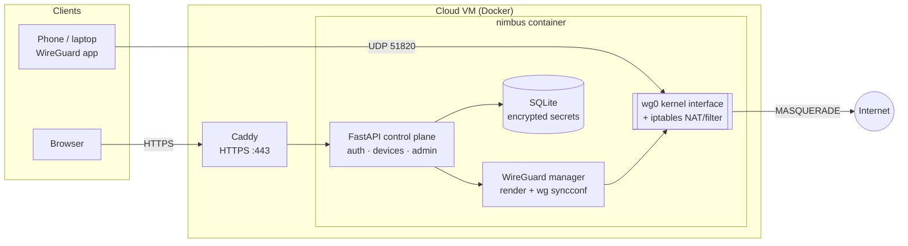

# NimbusVPN

**A cloud-based secure VPN you host yourself.** NimbusVPN pairs the WireGuard® data plane
(modern, audited cryptography in the Linux kernel) with a hardened control plane: a web
dashboard and REST API for users, devices, keys, two-factor sign-in and auditing. One
`docker compose up` or one `terraform apply` puts it on a cloud server.

```
 phone / laptop ──WireGuard (UDP 51820, ChaCha20-Poly1305 + PSK)──►  cloud VM  ──NAT──► Internet
                                                                       │
 browser ─────────HTTPS (Caddy, Let's Encrypt)──────────────────────► dashboard + API
```

## Features

**Secure tunnel**
- WireGuard (Noise IK: Curve25519, ChaCha20-Poly1305, BLAKE2s) plus a **per-device preshared
  key** for an extra symmetric layer (post-quantum hedge).
- Full-tunnel profiles by default (`0.0.0.0/0, ::/0`): IPv4 *and* IPv6 go through the VPN, so
  neither leaks. DNS is pushed to clients.
- **Client isolation:** VPN clients cannot reach each other.
- **Cloud-metadata protection:** clients can never reach `169.254.0.0/16` (the cloud instance
  metadata service), and the instance enforces IMDSv2 with hop limit 1.

**Zero-retention keys**
- Server-generated private keys are shown **once** (QR code + `.conf` download) and never
  stored. Or bring your own key: register only the public key and the private key never
  leaves the device.
- Secrets the server must keep (preshared keys, the server key, TOTP seeds) are encrypted at
  rest with AES-256-GCM, each bound to its record. The live `wg0.conf` sits on a tmpfs.
- One-click **key rotation**, instant **revocation** (disable/delete), and **expiring access**
  (e.g. a 7-day guest device).

**Hardened control plane**
- Argon2id password hashing, short-lived signed tokens with server-side revocation.
- **TOTP two-factor authentication** with replay protection.
- Account lockout plus per-IP rate limiting. Unknown and real usernames get the same responses.
- Role-based access (admin/user), per-user device quotas, full **audit log**.
- Strict security headers (CSP without inline script, no framing, HSTS via Caddy).

**Cloud-ready operations**
- Docker image with least privilege (`NET_ADMIN` + `NET_RAW` only, `no-new-privileges`).
- Caddy reverse proxy with automatic HTTPS and HTTP/3.
- `install.sh` for any Ubuntu/Debian VM (DigitalOcean, Hetzner, GCP, Azure, Oracle, AWS...),
  with optional host hardening (ufw, fail2ban, unattended upgrades, key-only SSH).
- Terraform module for AWS: encrypted EBS, Elastic IP, a minimal security group, IMDSv2.
- Self-healing: a reconcile loop converges WireGuard with the database every 30 s.

## Architecture



The database is the source of truth. Every change (and a timer every 30 s) renders the
desired WireGuard configuration and applies it with `wg syncconf`, which changes only what
differs, so connected peers are not dropped. See [docs/ARCHITECTURE.md](docs/ARCHITECTURE.md).

## Quick start

### 1. Try it locally (no root, no WireGuard needed)

The `dryrun` backend renders configs without touching network interfaces:

```bash
python -m venv .venv && source .venv/bin/activate
pip install -e ".[dev]"

export NIMBUS_SECRET_KEY="$(python -m nimbusvpn gen-secret)"
export NIMBUS_WG_BACKEND=dryrun NIMBUS_DATA_DIR=./data
export NIMBUS_ADMIN_USERNAME=admin NIMBUS_ADMIN_PASSWORD='choose-a-long-password'
python -m nimbusvpn serve      # → http://127.0.0.1:8000
```

### 2. Deploy on any cloud VM

Create an Ubuntu 24.04 VM. Open **UDP 51820** and **TCP 80/443** in its cloud firewall and point
a DNS record at it. Then:

```bash
git clone https://github.com/purnendukumarghosh/NimbusVPN.git
cd NimbusVPN
sudo ./deploy/scripts/install.sh --domain vpn.example.com --harden
```

The script installs Docker, loads the WireGuard module, writes `.env` with fresh random
secrets and starts the stack. It saves the initial admin password to
`/root/nimbusvpn-initial-admin.txt`. Without `--domain` it uses `<public-ip>.sslip.io`.

### 3. Deploy on AWS with Terraform

```bash
cd deploy/terraform/aws
cp terraform.tfvars.example terraform.tfvars   # set region, optional domain / SSH
terraform init && terraform apply
terraform output dashboard_url
terraform output -raw admin_password
```

Allow about 3–5 minutes for cloud-init to finish. If the repository is private, set
`repo_url` to a URL the instance can clone (a fork, or a URL with a read-only token).

### Connect a device

1. Sign in to the dashboard, **change the admin password** and **turn on 2FA** (Account tab).
2. **Devices → Add device**, give it a name, and optionally an expiry.
3. Scan the QR code with the WireGuard app (Android/iOS), or download the `.conf` and import
   it (Windows/macOS/Linux: `wg-quick up ./nimbus-laptop.conf`).
4. The device appears **Online** after its first handshake.

The profile is shown only once. If you lose it, use **Rotate keys** to issue a new one.

## Configuration

All settings are environment variables (see [`.env.example`](.env.example)).

| Variable | Default | Purpose |
|---|---|---|
| `NIMBUS_SECRET_KEY` | *required* | Master secret (≥ 32 chars): token signing + at-rest encryption |
| `NIMBUS_PUBLIC_ENDPOINT` | `vpn.example.com` | Host clients connect to |
| `NIMBUS_DOMAIN` | *required by compose* | Dashboard domain for Caddy/HTTPS |
| `NIMBUS_ADMIN_USERNAME` / `_PASSWORD` | – | First admin, created when no users exist |
| `NIMBUS_WG_BACKEND` | `linux` | `linux` (kernel WireGuard) or `dryrun` |
| `NIMBUS_WG_PORT` | `51820` | WireGuard UDP port |
| `NIMBUS_WG_SUBNET_V4` / `_V6` | `10.8.0.0/24` / `fd42:4e:42::/64` | Tunnel address pools (empty V6 disables IPv6) |
| `NIMBUS_CLIENT_DNS` | `1.1.1.1, 1.0.0.1` | DNS servers pushed to clients |
| `NIMBUS_CLIENT_ALLOWED_IPS` | `0.0.0.0/0, ::/0` | Routes sent through the tunnel (split tunnel: narrow this) |
| `NIMBUS_CLIENT_ISOLATION` | `true` | Block client-to-client traffic |
| `NIMBUS_BLOCKED_DESTINATIONS` | `169.254.0.0/16` | Networks clients may never reach |
| `NIMBUS_MAX_DEVICES_PER_USER` | `5` | Default device quota (admins can override per user) |
| `NIMBUS_ACCESS_TOKEN_TTL_MINUTES` | `60` | Dashboard session lifetime |
| `NIMBUS_LOGIN_MAX_ATTEMPTS` / `_LOCKOUT_MINUTES` | `5` / `15` | Account lockout policy |
| `NIMBUS_WAN_INTERFACE` | `eth0` | Interface VPN traffic is NATed out of |
| `NIMBUS_RUNTIME_DIR` | `$DATA_DIR/run` | Where the live `wg0.conf` is written (tmpfs in Docker) |
| `NIMBUS_ENABLE_API_DOCS` | `false` | Serve OpenAPI docs at `/api/docs` |

## API

Every endpoint is JSON, and all except login need `Authorization: Bearer <token>`.
Set `NIMBUS_ENABLE_API_DOCS=true` for interactive OpenAPI docs.

| Method | Path | Description |
|---|---|---|
| `POST` | `/api/auth/login` | Username + password (+ `totp_code`) → access token |
| `POST` | `/api/auth/logout` | Revoke all of the caller's tokens |
| `GET` | `/api/auth/me` | Current user |
| `POST` | `/api/auth/password` | Change password (revokes other sessions) |
| `POST` | `/api/auth/totp/setup` · `/enable` · `/disable` | Manage two-factor auth |
| `GET` / `POST` | `/api/devices` | List / create devices (`?scope=all` for admins) |
| `GET` / `PATCH` / `DELETE` | `/api/devices/{id}` | Inspect, rename, enable/disable, set expiry, delete |
| `POST` | `/api/devices/{id}/rotate` | New key pair + PSK; returns the new profile once |
| `GET` | `/api/devices/{id}/config` | Re-download a profile (bring-your-own-key devices only) |
| `GET` / `POST` | `/api/admin/users` | List / create users |
| `PATCH` / `DELETE` | `/api/admin/users/{id}` | Role, enable, reset password, unlock, reset 2FA, delete |
| `GET` | `/api/admin/server` | Interface state, peers online, sync status |
| `POST` | `/api/admin/sync` | Force a WireGuard sync |
| `GET` | `/api/admin/audit` | Audit log (`?action=login` to filter) |

## CLI

```bash
python -m nimbusvpn serve                       # run API + WireGuard manager
python -m nimbusvpn create-admin --username me  # create an admin / reset a password
python -m nimbusvpn gen-secret                  # print a random NIMBUS_SECRET_KEY
python -m nimbusvpn show-config                 # server config with secrets redacted
# inside Docker:  docker compose exec nimbus python -m nimbusvpn create-admin --username me
```

## Project layout

```
nimbusvpn/
  config.py      settings (NIMBUS_* environment variables, validated)
  crypto.py      WireGuard keys, HKDF, AES-256-GCM secret box
  security.py    Argon2id, tokens, TOTP, rate limiting
  ipam.py        tunnel address allocation
  wireguard.py   config rendering, iptables policy, linux/dryrun backends, sync manager
  db.py          SQLAlchemy models: users, devices, audit events
  api/           auth, devices, admin routers
  static/        dashboard (vanilla JS, no build step, CSP-friendly)
deploy/
  caddy/         reverse proxy with automatic HTTPS
  scripts/       install.sh for any Ubuntu/Debian VM
  terraform/aws/ EC2 + Elastic IP + security group + cloud-init
docs/            architecture and security model
tests/           pytest suite (API, crypto, WireGuard rendering)
```

## Development

```bash
pip install -e ".[dev]"
pytest            # 53 tests; uses the dryrun backend, no root needed
ruff check . && ruff format --check .
```

CI runs lint, tests (Python 3.11–3.13, with `wireguard-tools` for config validation), a
Docker build, `terraform validate` and `shellcheck`.

## Troubleshooting

- **Device never comes online:** check UDP 51820 is open in the cloud firewall/security group,
  and that `NIMBUS_PUBLIC_ENDPOINT` resolves to the server. `docker compose logs nimbus`
  shows sync errors; the Server tab shows the last sync status.
- **`ip6tables` errors at start-up:** the host has no IPv6 NAT support. Set
  `NIMBUS_WG_SUBNET_V6=` (empty) to run IPv4-only. Clients still route `::/0` into the
  tunnel, so IPv6 cannot leak.
- **Locked out:** `docker compose exec nimbus python -m nimbusvpn create-admin --username admin`.
- **Certificate errors:** the DNS record must point at the server *before* Caddy starts,
  and TCP 80/443 must be reachable.

## Security

See [docs/SECURITY.md](docs/SECURITY.md) for the threat model, what is protected and the
known limits. Please report vulnerabilities privately to the maintainer.

---

WireGuard is a registered trademark of Jason A. Donenfeld. NimbusVPN is not affiliated with
or endorsed by the WireGuard project.
