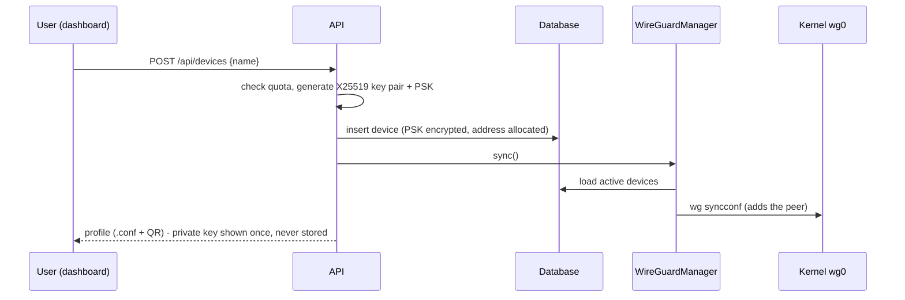

# Architecture

NimbusVPN has two planes:

| Plane | What it does | Implementation |
|---|---|---|
| **Data plane** | Encrypts and forwards packets | Linux kernel WireGuard (`wg0`) + iptables NAT/filtering |
| **Control plane** | Decides *who* may connect and *how* | FastAPI service, SQLite, dashboard |

The control plane never handles VPN traffic. If it crashes or restarts, established
tunnels keep working; only management is unavailable.

## Components

```
nimbusvpn/
├── config.py      Settings, validated at start-up (bad subnets or a weak secret fail fast)
├── crypto.py      X25519 key pairs, preshared keys, HKDF key derivation, AES-256-GCM SecretBox
├── security.py    Argon2id, HS256 access tokens, TOTP, sliding-window rate limiter
├── ipam.py        Address allocation (IPv4 host N ↔ IPv6 host N)
├── db.py          User, Device, AuditEvent models
├── wireguard.py   Renderers, firewall policy, Linux/dry-run backends, WireGuardManager
├── api/           auth.py, devices.py, admin.py routers
├── deps.py        Request context, auth dependencies, audit helper
├── main.py        App factory, lifespan, security headers, reconcile loop
└── cli.py         serve, create-admin, gen-secret, show-config
```

## Desired-state reconciliation

The database is the single source of truth. `WireGuardManager.sync()`:

1. Loads every device and keeps only the *active* ones (device enabled, owner enabled, not
   expired).
2. Decrypts each preshared key and renders a complete `wg-quick` config, including the
   server's address, listen port, private key, iptables `PostUp`/`PostDown` policy and one
   `[Peer]` per device.
3. Writes it atomically (mode `0600`) to the runtime directory, which is a tmpfs in Docker.
4. Brings the interface up with `wg-quick up` the first time. After that it runs
   `wg-quick strip | wg syncconf`, which applies only the differences, so connected peers are
   not dropped.

`sync()` runs after every mutating API call and also every
`NIMBUS_RECONCILE_INTERVAL_SECONDS` (30 s) from a background task. This one loop handles
several jobs:

- **Expiry:** a device whose `expires_at` has passed falls out of the next render.
- **Crash recovery:** if a sync failed (for example the interface was down), the next tick
  retries.
- **Drift:** manual `wg set` changes are reverted to the database's view.

## Request flow: adding a device



## Network policy (rendered into PostUp)

For each address family:

```
FORWARD 1  -i wg0 -d <blocked destination> -j DROP      # e.g. 169.254.0.0/16 (cloud metadata)
FORWARD 2  -i wg0 -o wg0 -j DROP                         # client isolation (optional)
FORWARD 3  -i wg0 -o eth0 -j ACCEPT                      # clients → internet
FORWARD 4  -i eth0 -o wg0 -m conntrack --ctstate RELATED,ESTABLISHED -j ACCEPT
nat        -s <tunnel subnet> -o eth0 -j MASQUERADE
```

Rules are inserted at the top of `FORWARD` in order, so they take effect even when the host
already has a firewall. `PostDown` removes exactly the same rules.

## Deployment topology

```
Internet ──► Cloud firewall / security group (UDP 51820, TCP 80/443 [, SSH from admin IP])
              │
              ├── UDP 51820 ──► nimbus container (NET_ADMIN, NET_RAW) ── wg0 ── NAT ──► eth0
              └── TCP 443   ──► caddy container (TLS, HSTS) ──► nimbus:8000 (internal network only)
```

- Port 8000 is never published; only Caddy can reach it.
- `/data` (Docker volume) holds the SQLite database and the encrypted server key.
- `/run/nimbusvpn` (tmpfs) holds the rendered `wg0.conf`.

## Scaling notes

A single small VM handles hundreds of peers; WireGuard runs in the kernel and the control
plane is idle most of the time. For multiple regions, run one NimbusVPN per region. The
data model keeps everything per-server, so a future "multi-node" mode would add a `node_id`
to devices and run one agent per node consuming the same desired state.
